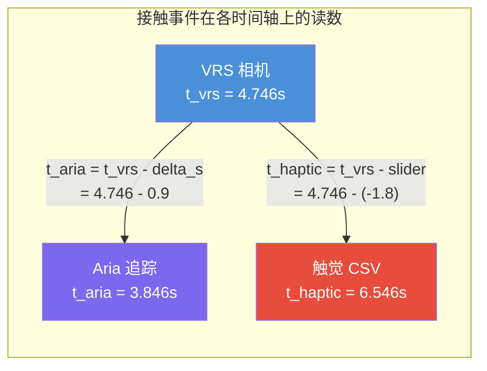
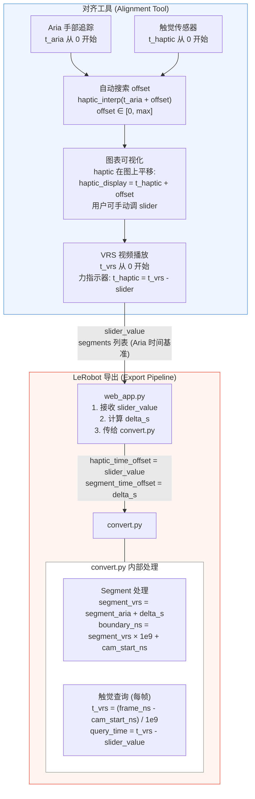
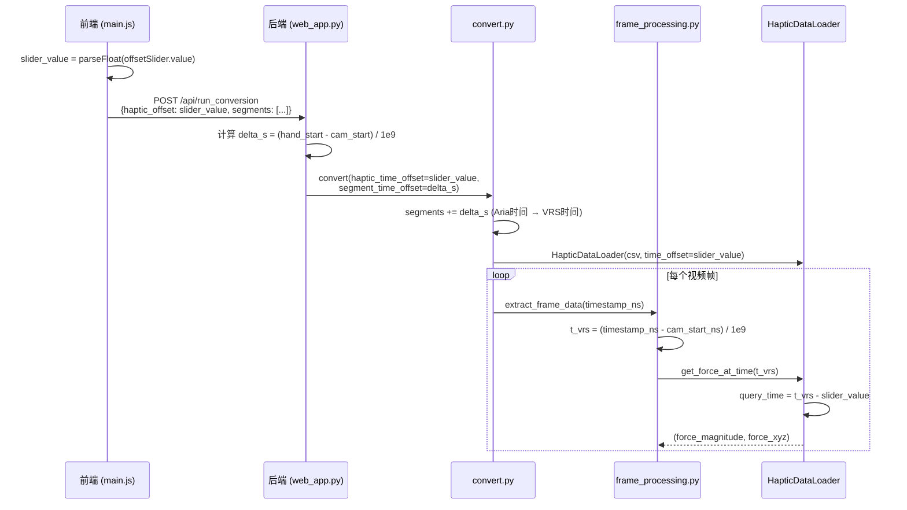

# 时间对齐说明

本文档描述 Aria 眼镜视频、手部追踪和触觉传感器之间的时间对齐机制，以及 LeRobot 导出时如何正确应用时间偏移。

---

## 1. 三个独立时间基准

系统中存在三条独立的时间轴，各自从 0 开始归零：

| 时间基准 | 起点定义 | 归零代码位置 | 用途 |
|---|---|---|---|
| **VRS 相机时间** `t_vrs` | RGB 相机第一帧 = 0 | `frame_processing.py:56` | 视频播放、LeRobot 帧时间戳 |
| **Aria 手部追踪时间** `t_aria` | 第一个有效手部帧 = 0 | `aria_haptic_align.py:222` | 对齐工具内部计算 |
| **触觉 CSV 时间** `t_haptic` | CSV 第一行 = 0 | `convert.py:68` / `aria_haptic_align.py:431` | 力传感器原始数据 |

### 归零方式

```
VRS 相机:      camera_start_ns → t_vrs = (timestamp_ns - camera_start_ns) / 1e9
Aria 手部追踪:  hand_start_ns   → t_aria = timestamps - timestamps[0]
触觉 CSV:      first_row       → t_haptic = relative_time (已从 0 开始)
```

### 时间基准之间的偏移

```
delta_s = (hand_start_ns - camera_start_ns) / 1e9
```

- `delta_s > 0`：手部追踪比相机**晚启动** delta_s 秒
- `delta_s < 0`：手部追踪比相机**早启动**

---

## 2. 时间线示意图

### 2.1 三条时间线的物理关系

以 `delta_s = 0.9s`、`slider_value = -1.8s` 为例：

```mermaid
gantt
    title 三条时间线在绝对时间上的位置 (delta_s = 0.9s)
    dateFormat X
    axisFormat %s

    section VRS 相机
    t_vrs = 0 起点           :milestone, 0, 0
    VRS 相机时间轴            :active, 0, 80

    section Aria 手部追踪
    camera 已走 0.9s (delta_s) :crit, 0, 9
    t_aria = 0 起点           :milestone, 9, 9
    Aria 追踪时间轴            :active, 9, 80

    section 触觉 CSV
    t_haptic = 0 起点          :milestone, 0, 0
    触觉 CSV 时间轴            :active, 0, 80
```



> **转换关系**：`t_aria = t_vrs - delta_s`，`t_haptic = t_vrs - slider_value`

### 2.2 同一物理事件在三条时间线上的位置



> 前端直接用 VRS 时间近似 Aria 时间，所以手动标定的 slider 值
> 直接建立了 `t_vrs → t_haptic` 的映射：`t_haptic = t_vrs - slider_value`
> 即：`6.546 = 4.746 - (-1.800)` ✓

### 2.3 数据流全景图



### 2.4 Offset 传递链路



---

## 3. 对齐工具流程

### 3.1 自动对齐

`aria_haptic_align.py` 的 `find_optimal_offset()` 方法：

1. 将 Aria 手部距离（归一化取反）和触觉力（归一化）分别插值
2. 在 `[0, max_offset]` 范围内（正值）逐步搜索
3. 对每个 offset，计算 `aria_interp(t)` 与 `haptic_interp(t + offset)` 的相关性
4. 取相关性最高的 offset 作为 `optimal_offset`

```python
# aria_haptic_align.py:654
haptic_samples = haptic_interp(common_times + offset)
```

**语义**：在 Aria 时间 t 处，对应的触觉样本在 `t_haptic = t + offset`。

### 3.2 图表可视化

前端图表上同时显示 Aria 曲线和触觉曲线，触觉数据按 offset 平移：

```javascript
// main.js:1379
hapticTimestampsOffset = hapticTimestamps.map(t => t + offset);
```

**含义**：把触觉时间轴上的点 `t_haptic` 平移到 `t_haptic + offset` 后在 Aria 时间轴上显示。

当对齐正确时：`t_haptic + offset = t_aria`，即 `t_haptic = t_aria - offset`。

### 3.3 用户手动微调

用户可以拖动 slider（范围 [-10, 20]），slider 值直接用于图表平移。
与自动搜索不同的是，slider 可以取负值。

**关键区别**：

- **自动搜索的 `optimal_offset`**：始终为正值，定义在 Aria 时间基准上
- **用户手动设置的 slider**：可正可负，直接对应 VRS 视频播放体验

由于前端 VRS 视频播放使用 VRS 相机时间（`t_vrs`），而前端**近似**地将 `t_vrs` 当作 `t_aria`
（忽略了 delta_s），用户手动标定的 slider 值实际上直接建立了：

```
t_haptic = t_vrs - slider_value
```

### 3.4 力指示器实时查询

播放 VRS 视频时，实时显示当前帧对应的力值：

```javascript
// main.js:1687
const hapticTime = ariaTime - currentOffset;
// ariaTime ≈ vrsCurrentTime (前端近似)
// hapticTime = vrsTime - sliderValue
```

---

## 4. LeRobot 导出流程

### 4.1 前端传参

```javascript
// main.js:1841, 1879
const currentOffset = parseFloat(offsetSlider?.value) || optimalOffset || 0;
// ...
body: JSON.stringify({
    haptic_offset: currentOffset,  // slider 值直接传
    segments: segmentData,         // Aria 时间基准的片段
})
```

### 4.2 后端处理 (`web_app.py`)

```python
# 1. 接收 slider 值
haptic_offset = data.get('haptic_offset', 0)  # 用户手动或自动标定值

# 2. 计算 delta_s（仅用于 segment 时间基准转换）
delta_s = (hand_start_ns - camera_start_ns) / 1e9

# 3. 传给 convert.py
convert_kwargs = {
    'haptic_time_offset': haptic_offset,   # slider 值直接传，不做转换
    'segment_time_offset': delta_s,         # segment 需要从 Aria 时间 → VRS 时间
}
```

**为什么 `haptic_time_offset` 直接传 slider 值？**

用户手动标定时看的是 VRS 视频，调 slider 直到力曲线和视频帧匹配。
slider 值已经包含了所有时间基准差异（包括 delta_s），不需要再做转换。

**为什么 `segment_time_offset` 需要 delta_s？**

segment 的 start/end 来自 alignment tool，是在 Aria 时间基准上的。
convert.py 中 `create_segment_boundaries()` 以 VRS 相机 `start_timestamp_ns` 为基准，
所以需要加上 delta_s 把 Aria 时间转到 VRS 相机时间。

### 4.3 convert.py 查询

```python
# convert.py:156 - HapticDataLoader.get_force_at_time()
query_time = time_s - self.time_offset
# time_s = VRS 相机相对时间 (frame_processing.py:56)
# time_offset = slider_value
# query_time = t_vrs - slider_value = t_haptic
```

```python
# convert.py:419-422 - segment 时间基准转换
segment_pairs = [(start + segment_time_offset, end + segment_time_offset)
                 for start, end in segment_pairs]
# start/end 原本在 Aria 时间基准
# + delta_s 后转到 VRS 相机时间基准
```

```python
# chunking.py:370-371 - segment 秒 → 纳秒
boundaries_ns.append(int(start_s * 1e9) + start_timestamp_ns)
# start_s 现在是 VRS 相机相对时间
# + start_timestamp_ns (VRS 相机第一帧绝对时间)
# = 绝对纳秒时间戳
```

---

## 5. 核心公式汇总

### 5.1 时间基准转换

| 公式 | 含义 |
|---|---|
| `t_aria = t_vrs - delta_s` | VRS 相机时间 → Aria 时间 |
| `t_vrs = t_aria + delta_s` | Aria 时间 → VRS 相机时间 |
| `delta_s = (hand_start_ns - camera_start_ns) / 1e9` | 两个时间基准的偏移量 |

### 5.2 触觉对齐（用户手动标定）

| 公式 | 含义 |
|---|---|
| `t_haptic = t_vrs - slider_value` | 从 VRS 帧时间查触觉原始时间 |
| `t_haptic_display = t_haptic + slider_value` | 触觉在图表上的显示位置 |

### 5.3 触觉对齐（自动标定）

| 公式 | 含义 |
|---|---|
| `t_haptic = t_aria + optimal_offset` | alignment 搜索语义（`optimal_offset >= 0`） |
| `t_haptic_display = t_haptic + optimal_offset` | 图表显示（和手动一致） |

### 5.4 LeRobot 导出

| 公式 | 代码位置 | 含义 |
|---|---|---|
| `haptic_time_offset = slider_value` | `web_app.py:911` | 直接传 slider 值 |
| `query_time = t_vrs - time_offset` | `convert.py:156` | 帧级触觉力查询 |
| `segment_vrs = segment_aria + delta_s` | `convert.py:421` | segment 时间基准转换 |
| `boundary_ns = segment_vrs × 1e9 + cam_start_ns` | `chunking.py:370` | segment 秒转纳秒 |

---

## 6. 关键代码位置

| 模块 | 文件 | 行号 | 功能 |
|---|---|---|---|
| Aria 数据归零 | `aria_haptic_align.py` | 222 | `timestamps = timestamps - timestamps[0]` |
| 触觉数据归零 | `aria_haptic_align.py` | 431 | `timestamps = timestamps - timestamps[0]` |
| Offset 搜索 | `aria_haptic_align.py` | 636-666 | 网格搜索最优 offset |
| 搜索核心公式 | `aria_haptic_align.py` | 654 | `haptic_interp(common_times + offset)` |
| Segment 提取 | `aria_haptic_align.py` | 859 | `haptic_aligned_time = haptic_timestamps + offset` |
| 图表平移显示 | `main.js` | 1379 | `hapticTimestamps.map(t => t + offset)` |
| 力指示器查询 | `main.js` | 1687 | `hapticTime = ariaTime - currentOffset` |
| 导出传参 | `main.js` | 1841 | 读取 slider 值传给后端 |
| delta_s 计算 | `web_app.py` | 895 | `(hand_start_ns - camera_start_ns) / 1e9` |
| haptic offset 传递 | `web_app.py` | 911 | `haptic_time_offset: haptic_offset` |
| segment offset | `web_app.py` | 913 | `segment_time_offset: delta_s` |
| 触觉力查询 | `convert.py` | 156 | `query_time = time_s - self.time_offset` |
| 帧时间计算 | `frame_processing.py` | 56 | `(timestamp_ns - global_start_ns) / 1e9` |
| segment 加载 | `chunking.py` | 319-345 | `load_segment_pairs()` |
| segment → ns | `chunking.py` | 370-371 | `int(start_s * 1e9) + start_timestamp_ns` |

---

## 7. 常见问题 / 踩坑记录

### Q1: 为什么不能对手动标定的 slider 值做 delta_s 转换？

用户手动标定时看的是 **VRS 视频帧**，前端播放用的是 **VRS 相机时间**。
slider 值直接在 VRS 时间基准上建立了与触觉时间的映射，delta_s 差异已被"吸收"。
如果再加 delta_s 转换，等于重复补偿，导致偏移。

### Q2: 为什么 segment 需要 delta_s 但 haptic offset 不需要？

- **segment start/end** 来自 `aria_haptic_align.py:859`，在 **Aria 时间基准**上
- **haptic offset (slider)** 来自前端，在 **VRS 相机时间基准**上
- convert.py 内部统一使用 VRS 相机时间基准，所以 segment 需要 `+ delta_s`

### Q3: 自动标定的 optimal_offset 和手动 slider 值含义一样吗？

不完全一样：
- **自动 optimal_offset**：在 Aria 时间基准上，始终 >= 0
- **手动 slider 值**：在 VRS 时间基准上（因为看着视频调的），可正可负

但在当前实现中，前端把 `t_vrs` 直接当 `t_aria` 用（忽略 delta_s），
所以数值上 slider 值等于自动值需要乘 -1 再微调。

### Q4: 前端 `ariaTime - offset` 还是 `ariaTime + offset`？

**答案是减号**（`ariaTime - offset`）。

推导：图表上 `haptic_display = t_haptic + offset`，对齐时 `haptic_display = ariaTime`，
所以 `t_haptic = ariaTime - offset`。

### Q5: 修改 convert.py 后需要重启服务吗？

**需要**。Flask debug 模式的 reloader 只监控主项目目录。
`Aria-to-Lerobot/convert.py` 通过 `importlib.util` 加载并缓存在 `sys.modules` 中，
修改后必须手动重启才能生效。

### Q6: 怎么验证导出的对齐是否正确？

1. 查看终端日志中 `haptic_time_offset` 的值，应等于 slider 值
2. 用 LeRobot 可视化工具播放导出数据集
3. 观察力曲线上升/下降点是否与视频中手指接触/离开物体同步
